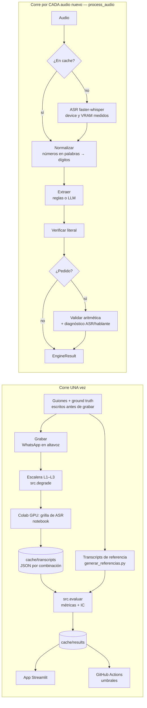

# Pipeline — De la voz al registro (HW05)

Repositorio: https://github.com/JazminGalindoo/HW05_VOZ_A_REGISTRO

Dos tareas, **un solo motor**: `process_audio(audio, schema)` en `src/engine.py` convierte un audio en un registro con cada campo marcado `verificado` / `sin_verificar`. La Tarea 1 lo usa con `schema="entrevista"` y la Tarea 2 con `schema="pedido"`; lo único que cambia es el esquema de campos.

---

## Lo que corre UNA vez

| # | Paso | Comando / archivo | Decisión | Lo que se descartó y por qué |
|---|---|---|---|---|
| 1 | **Guiones** | `scripts_grabacion/guiones.md` | Escritos **antes** de grabar, con datos inventados; cada campo se pregunta en distinto orden en cada clip (`orden_campos`) | Guiones con el mismo orden: el extractor aprendería la posición y no el contenido |
| 2 | **Ground truth** | `data/ground_truth/*.csv` | Valores correctos de cada campo, escritos a mano, con las trampas marcadas (autocorrección, total erróneo) | Subtítulos de YouTube u otro ASR como referencia: mediría parecido con otro modelo, no exactitud (evaluación circular) |
| 3 | **Transcripts de referencia** | `python scripts_grabacion/generar_referencias.py` | Se generan del guion (solo el texto hablado). Si al grabar se dijo otra cosa, se corrige el guion y se regenera | Escribirlos a mano aparte: dos fuentes de verdad que se desincronizan |
| 4 | **Grabar** | celular, llamada de WhatsApp en altavoz | Audio real, de 2 a 4 min por clip | Corpus sintético (TTS): demasiado limpio, Whisper large lo transcribe casi perfecto y no hay nada que medir. La voz sintética solo se usó para probar que el pipeline corre; no está en el repo ni en las métricas |
| 5 | **Escalera de degradación** | `python -m src.degrade` | L1 WhatsApp (mono, Opus 12 kbps), L2 teléfono (300–3400 Hz, 8 kHz), L3 = L1 + ruido grabado a 10 dB. El SNR **se calcula** por RMS y se guarda por clip | `ffmpeg-python` (sin mantenimiento desde 2019): se llama a ffmpeg con `subprocess`. "Agregar ruido" sin medir el SNR |
| 6 | **Transcribir la grilla** | `notebooks/colab_gpu_benchmark.ipynb` | Es el **único** lugar donde se transcribe el corpus. Grilla en `config.yaml → experimentos`, reducida para < 40 min en una T4: small y large-v3 en float16 e int8 (todos los clips), glosario solo con large-v3 int8, CPU solo small int8 en 2 clips, escalera L1–L3 con large-v3 int8. Celda 3b: librerías CUDA 12 precargadas (Colab trae CUDA 13) + prueba real en GPU. Cache en Drive para retomar si Colab se cae; una corrida de calentamiento descartada por modelo | Transcribir en la app o en GitHub Actions: los runners no tienen GPU y la app tardaría minutos en arrancar. La grilla completa (7 combinaciones × todos los clips, CPU en todos): no entraba en el tiempo de una sesión gratis |
| 7 | **Cache** | `cache/transcripts/{clip}__{modelo}__{device}__{compute}__{glosario}__{nivel}.json` | Un JSON por combinación, con transcript, palabras con probabilidad, device y compute **reales**, tiempo y VRAM. Se sube al repo | Subir los audios o los pesos del modelo (pesan y contienen voces) |
| 8 | **Métricas** | `python -m src.evaluar` | Lee el cache, nunca transcribe. Escribe `cache/results/` para la app | Calcular métricas dentro de la app: no sería reproducible desde la terminal |
| 9 | **Regresión en CI** | `.github/workflows/regression.yml` | Tests + `python -m src.evaluar --verificar`: falla si el WER o la accuracy de la combinación vigilada salen de los umbrales | — |

## Lo que corre por CADA audio nuevo (`process_audio`)

| # | Paso | Módulo | Decisión | Lo que se descartó y por qué |
|---|---|---|---|---|
| 1 | **¿Ya está en cache?** | `engine.py` | Si existe el JSON de esa combinación, no se transcribe. Con `solo_cache: true` (app y CI) es imposible transcribir | — |
| 2 | **ASR** | `asr.py` | faster-whisper 1.2.1 (CTranslate2), español fijo. Glosario = `initial_prompt` + `hotwords` (verificado que existe en 1.2.1 con `inspect.signature`) | Modelos solo en inglés de los rankings públicos; whisper original de OpenAI (más lento y más VRAM) |
| 2a | **Prueba de GPU** | `asr.py` | El device y el compute se leen del objeto CTranslate2 (`model.model.device`). Ejemplo: pedir int8 en CPU corre como `int8_float32` | Confiar en el config: el ASR cae a CPU **en silencio** si no hay GPU |
| 2b | **VRAM** | `asr.py` | Hilo que lee la memoria de la GPU con `pynvml` cada 50 ms; se reporta pico − línea base | `torch.cuda.max_memory_allocated()`: CTranslate2 no usa el allocator de PyTorch, siempre daría ~0 |
| 3 | **Normalizar** | `normalize.py` | Igual para ASR y referencia: minúsculas, sin tildes, sin puntuación. Números con `text2num` y `threshold=0`. Reglas propias: ordinales protegidos ("cuartos de pollo"), "N años y medio" → N.5, "lucas" → ×1000 | Umbral por defecto de text2num ("dos" no se convertía); "y medio" en todos lados (rompía "litro y medio"); conservar tildes (penaliza "inglés"/"ingles") |
| 4 | **Extraer** | `extract_rules.py` / `extract_llm.py` | **Reglas:** cada campo tras una pregunta ancla; el pedido sale del **resumen final de la operadora**, que ya trae las autocorrecciones. **LLM:** Gemini `gemini-3-flash-preview` (nivel gratuito), temperatura 0, salida JSON estructurada con el JSON schema de `schemas.py` + validación + reintentos; pausa entre llamadas y espera ante el límite (429) | Extraer por posición en el texto. Pedir JSON "a mano" y parsearlo. Anthropic: requiere pago (y su API actual no permite temperatura 0) |
| 5 | **Verificar** | `verify.py` | Un valor es `verificado` solo si aparece **literal** en el transcript normalizado: números como número completo (90 no cuenta dentro de 2890), frases tal cual, categorías por sus palabras ("soles" → PEN) | Dejar que el LLM "corrija" al ASR: si acierta hoy, mañana corrige y se equivoca, y nadie se entera |
| 6 | **Validar** (pedido) | `validate.py` | Σ cantidad × precio − descuento contra el total dicho (tolerancia 0.5) | Confiar en el total que diga el LLM |
| 6a | **Diagnóstico** | `validate.py` | Si no cuadra: (1) si cuadraba en L0 y en este nivel no → error de ASR; (2) si algún número tiene probabilidad < 0.80 → error de ASR; (3) si no → error del hablante | Solo probabilidades: no aprovecha que tenemos el mismo audio en varios niveles |

## Cómo se mide

| Capa | Métricas | Detalle |
|---|---|---|
| Transcripción | WER, CER (jiwer) | WER de un conjunto = Σ errores / Σ palabras (no el promedio de WER). Se reporta si el **texto** cambió entre configuraciones, no solo la velocidad |
| Registro | Accuracy por campo, macro-F1 (nivel de inglés, método de pago), error absoluto (numéricos), % verificado | Comparación por tipo: números exactos, listas como conjunto, dirección con abreviaturas ("Jr." = "jirón") |
| Incertidumbre | IC 95 % por bootstrap de **clips** (1000 réplicas, semilla 42) | Comparaciones **pareadas** (mismos clips): si el IC de la diferencia incluye 0, la muestra no permite afirmar nada |
| Validación | Capturadas / perdidas / falsas alarmas por nivel; aciertos del diagnóstico | Contra las trampas marcadas en el ground truth |

Grupos que nunca se mezclan: cada combinación de ASR, el grupo **referencia** (texto humano como si fuera el ASR: mide solo la extracción) y cualquier clip sin ground truth (sintético), que se ignora y se lista.

## Problemas encontrados en el camino

- **Colab trae CUDA 13 y CTranslate2 4.8.4 necesita CUDA 12.** Al usar la GPU falla con `Library libcublas.so.12 is not found`.
  - **Arreglo:** `pip install nvidia-cublas-cu12 "nvidia-cudnn-cu12==9.*"` y precargar sus `.so` con `ctypes` (`RTLD_GLOBAL`) antes de importar faster-whisper. Está en la celda 3b del notebook, con una prueba real en GPU que falla en segundos si algo sigue mal.
  - **Lección:** que haya GPU no garantiza que la librería pueda usarla; el problema aparece recién al transcribir. Por eso hay una prueba real antes de la grilla, y el device se lee del modelo y se respalda con la VRAM medida.
- **PyAV 19 rompe faster-whisper 1.2.1** (quitó `metadata_errors`): se fijó `av==18.1.0` después de probar 15.1 a 18.1.
- **Items duplicados en las reglas** cuando el resumen repetía un producto: la suma daba el doble y el diagnóstico decía falsamente "error del hablante". Apareció al correr el pipeline real; se corrigió y tiene test.
- **Workflow de CI con YAML inválido** (un `: ` dentro de un comando) y **tests que no encontraban `src`** en CI: corregidos; desde entonces solo se mergea con el CI en verde.
- **Reglas escritas mirando los guiones**: su 100 % sobre referencias es una cota optimista; la prueba real es con la salida del ASR.

## Qué no se debe hacer con este sistema

- Usarlo para decidir sobre personas reales (contratar, rechazar) sin que una persona revise cada campo `sin_verificar`.
- Afirmar que un modelo es mejor que otro con una diferencia cuyo IC incluye 0.
- Generalizar a otros acentos, hablantes o dominios: el corpus son dos voces y un dominio por tarea.
